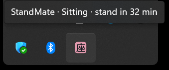
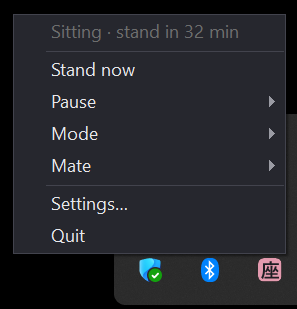
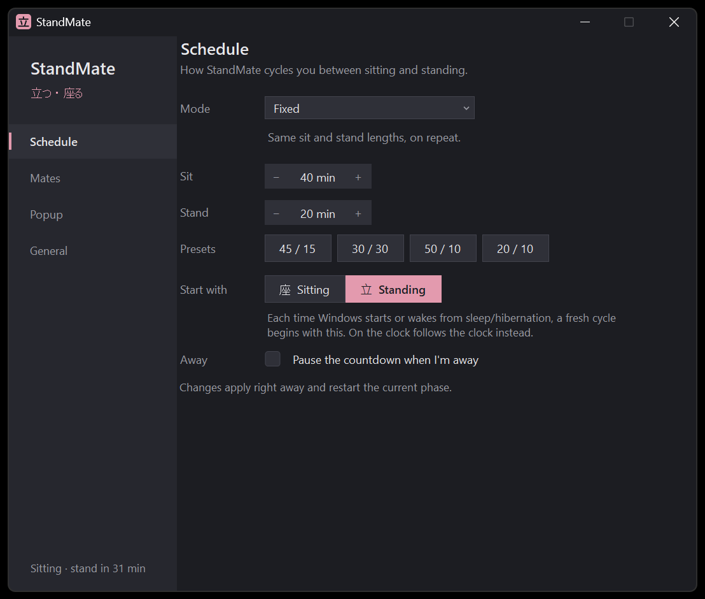

# StandMate 立つ・座る

A small lightweight app that helps you make use of your standing desk!
When it's time for you to stretch your chicken legs or hunker down, a GIF of your choice will play on your screen, accompanied by a sound of your preference.

- lives in the tray so it's out of sight
- can start automatically on boot-up
- only connects to the internet when you want to update the app
- NO annoying Windows notifications, no telemetry, no accounts
- consumes a dozen or so MB of RAM and virtually no CPU processing power
- it's just a **cute** little app (づ ◕‿◕ )づ

## Install

Download `StandMate-Setup.exe` from the repo's **Releases** page and run it.
Windows SmartScreen may warn about an unknown publisher because the installer isn't code-signed: choose
*More info → Run anyway*.

## Uninstall

It uninstalls like any other Windows program, from Control Panel!

Uninstalling keeps your mates and settings; you'll have to delete those manually. You can see their locations below in the Mates section.

## Using it

The app lives hidden at the right of your taskbar in the tray. The app will display either 座 for sitting, or 立 for standing.


Hovering over it will display the amount of time left.



Right click the icon and some settings will appear.



Left click and the app with all settings will pop up.



- Schedule: allows you to select how you want the timer to work
- Mates: you can select your GIF sets here
- Popup: customize where you want the popup to appear and how
- General: app-level settings

### Updating

Settings › General › **Check for updates**. If there's a newer version, **Update to x.y.z** downloads it, installs it
silently and brings StandMate straight back. Settings and mates are always kept. For minor and patch updates
(e.g. 1.2 → 1.3) the running timer carries on as well: *7 min of standing left* is still 7 min afterwards. A major
update (e.g. 1.x → 2.0) starts the timer fresh.

### Modes

| Mode | How it cycles |
|---|---|
| Fixed | same sit and stand lengths on repeat (presets 45/15, 30/30, 50/10, 20/10) |
| Sequence | your own loop, e.g. `sit 30, stand 10, sit 50, stand 15` |
| On the clock | stand at the same minute every hour, e.g. :50 to :00 |
| Progressive | sitting time is fixed, but standing starts short and grows longer each cycle, up to a maximum; obviously resets daily xD |
| Random | each sit and stand lasts a random length of time (within a selected range) |

### Starting, sleeping, and being away

- **Fresh start:** whenever StandMate starts (e.g. Windows boots) or the PC wakes from sleep/hibernation, a new cycle
  begins with your choice of **sitting or standing** (Settings › Schedule › *Start with*). *On the clock* follows the
  clock instead: waking up inside the stand window brings up the stand reminder straight away.
- **Away** (on by default, Settings › Schedule): after *N* minutes (5 by default) with no mouse/keyboard input,
  the countdown pauses until you're back. You have to options for your idle time:
  - *Rewind to my last input, then pause*: the idle minutes don't count; you come back to the time that was left
    when you last touched the PC
  - *Just pause*: the countdown stops when the idle time is noticed; the idle minutes count!

  Note: *On the clock* mode can't pause, so a reminder that pops up while you're away, waits for your input
- **Fullscreen:** reminders show even while you're in a game or a fullscreen video. If you'd rather they wait until
  it closes, turn on *Hold reminders until fullscreen apps close* (Settings › Popup)

### Popup placement

Settings › Popup: pick the desired screen, a corner/edge from the 3×3 grid, or
**Place by dragging…** to drag the popup anywhere (double-click to save); the size of the GIF and the volume of the sound are also adjustable here

## Mates (your own GIFs and sound effects)

A **mate** is a GIF + sound (+ optional caption) set for **standing up**, and for **sitting down**
The app comes with a simple default mate. Make your own in Settings › Mates › **New…**: choose any GIF (PNGs/JPGs work too)
and a WAV/MP3/WMA sound file for sitting and standing.

Mates live in `%APPDATA%\StandMate\mates\<name>\` as plain files plus a `mate.json`:

```json
{
  "name": "StandMate",
  "stand": { "image": "stand.gif", "sound": "stand.wav", "caption": "Stand up and stretch" },
  "sit":   { "image": "sit.gif",   "sound": "sit.wav",   "caption": "Take a seat" }
}
```

Settings are in `%APPDATA%\StandMate\settings.json`.

## Privacy

Away detection uses only the Windows function `GetLastInputInfo`, which returns *when* the last input happened
(a single number). StandMate never sees which keys you press or where your mouse is: it installs no keyboard/mouse
hooks, uses no raw input, and records nothing. Errors, if any, go to a local `error.log` in the settings folder.

Network: the only network code is the update check (`src/StandMate/Platform/UpdateClient.cs`), and it runs only when
you press *Check for updates* or *Update now*. It makes plain HTTPS downloads from the project's GitHub releases with a
generic `StandMate/<version>` user agent, and sends nothing about you or your PC.

## Building from source

Needs the [.NET SDK](https://dotnet.microsoft.com/download) (8 or newer; it targets .NET Framework 4.8) and
[Inno Setup 6](https://jrsoftware.org/isinfo.php):

```powershell
winget install Microsoft.DotNet.SDK.10
winget install JRSoftware.InnoSetup
powershell -ExecutionPolicy Bypass -File build.ps1      # -> dist\StandMate-Setup.exe
```

`build.ps1` runs the tests, publishes the app and builds the installer (its version comes from `<Version>` in
`src/StandMate/StandMate.csproj`).

For development, `StandMate.exe --fast` treats minutes as seconds (and "away" as 10 s of no input) so you can watch
a whole cycle quickly. `--update-url <url>` reads `latest.json` from another place (e.g. a local test server) instead
of GitHub; the signature is still required.

```
src/StandMate/Core       schedule engine, modes, settings, mates (pure logic, unit-tested)
src/StandMate/Platform   Win32 bits: idle time, fullscreen, audio (MCI), autostart
src/StandMate/UI         tray icons, popup, settings, mate editor
tests/StandMate.Tests    xUnit tests for the engine and modes
installer/               Inno Setup script
tools/                   release key generator, icon generator
```

## License

- **Code:** [GNU General Public License v3.0](LICENSE). You may use, modify and share it, but versions you distribute
  must stay open source under the same license.
- **Default mate art:** © Victor Gordan, [CC BY-NC 4.0](https://creativecommons.org/licenses/by-nc/4.0/). Free to
  share and adapt with credit, but not for commercial use.
- **Sounds:** Kenney, CC0 (public domain).

## Credits

See [CREDITS.md](CREDITS.md).
